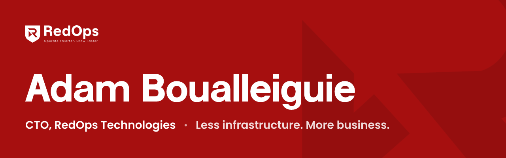

<picture>
  <source media="(prefers-color-scheme: dark)" srcset="./banner-dark.png">
  
</picture>

 

I'm CTO of [RedOps Technologies](https://redops-tech.com). We build complex platforms designed to serve millions, on Cloudflare's global network, and the systems that run the business, on ERPNext. Then we run them, so our clients can focus on their business.

I lead our architecture and engineering. We work with companies anywhere, remotely, from Tunisia.

### What I work on

- **Platforms and products on Cloudflare**: Workers, Zero Trust, security and bot protection. Fast wherever the users are, secure from day one, cheap to run.
- **Cloud bills**: we decide what belongs on Cloudflare and what stays on classic infrastructure, for the best security and cost. We do not move everything to the edge.
- **ERPNext**: implementation, migration from Odoo or spreadsheets, hosting, support and custom Frappe apps.
- **Our own products**: NolagChess (coming soon), RedOps AI and RedOps Insights.

### Writing

- [Harvest now, decrypt later: the quantum problem is already here](https://redops-tech.com/resources/blog/harvest-now-decrypt-later/): why recorded traffic is already at risk, and what we did about it on our own platform.
- More on the [RedOps blog](https://redops-tech.com/resources/blog/).

### Open source

| Project | What it does |
| --- | --- |
| [ProxGen](https://github.com/adamBoualleiguie/ProxGen) | Terraform for Proxmox: virtual machines from cloud-init templates, created and scaled from code |
| [erpnext-apm](https://github.com/adamBoualleiguie/erpnext-apm) | Elastic APM for ERPNext: every request traced and every error captured, with no change to ERPNext's core |
| [k3smp](https://github.com/adamBoualleiguie/k3smp) | A real multi-node k3s cluster on your machine, each node in its own Multipass VM, set up automatically |
| [opentelemetry-demo-basel-integration](https://github.com/adamBoualleiguie/opentelemetry-demo-basel-integration) | Bazel brought into the OpenTelemetry demo, step by step, across 20+ services in a dozen languages |

### Before RedOps

Six years of DevOps and platform engineering for fintech and e-commerce: Kubernetes and GitOps (Argo CD, Flux), Terraform and Ansible, Proxmox and Harvester, GitLab CI at scale, DevSecOps pipelines, and observability with OpenTelemetry.

### Work with us

Want to know where your infrastructure is losing money or exposed? Start with a [free edge and security audit](https://redops-tech.com/free-audit), or [book a call](https://redops-tech.com/book).

[redops-tech.com](https://redops-tech.com) · [LinkedIn](https://www.linkedin.com/in/boualleiguieadam/)
